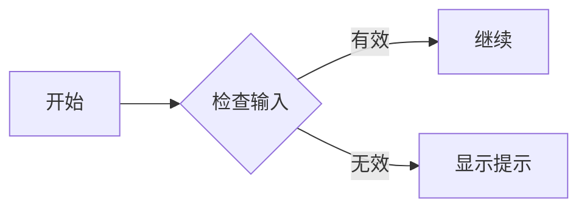
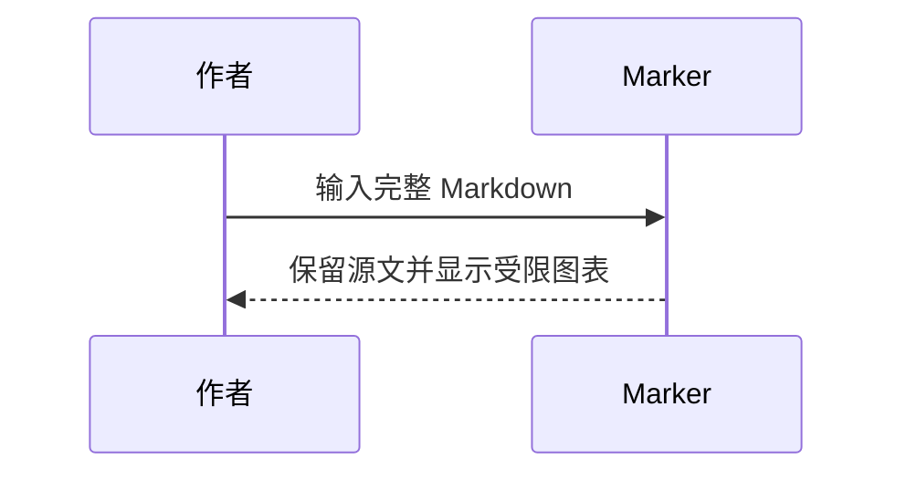
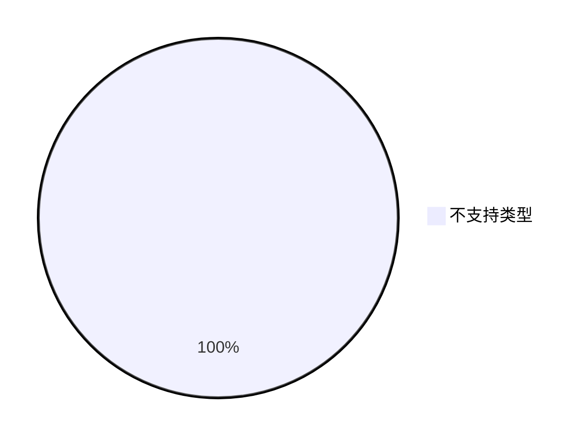

# 测试文档

这是一份可直接打开并用于手工检查的中文 Markdown 样例，覆盖基础格式、U3 导航/灯箱/专注操作和 U4 脚注、提示框、数学、Mermaid。普通样张保持轻量；高负载、超限和危险 payload 不放在此文档中。测试时请留意原文是否保留、装饰是否重叠、内容是否被截断，以及宽内容是否撑破页面。

项目当前的呈现编辑器与 Markdown HTML 解析结果不保证完全相同。复杂空单元格、参考式图片及第 9 节扩展需按实际能力检查；原始 HTML 禁用，本地图片仅允许文档目录内的受控资源。预期失败的图片样例会单独标明，正常样例的相对路径应能解析。显示降级时仍应保留完整源码。

## 1. 标题与段落

### ATX 标题三级

#### ATX 标题四级

##### ATX 标题五级

###### ATX 标题六级

Setext 一级标题
===============

Setext 二级标题
---------------

中文段落与 English 混排，包含数字 12345、标点“，。！？；：”和 emoji 🧭 🌱 📚。再放一些连续文字，观察自动换行、字体和标点间距是否自然。This sentence checks English word wrapping beside 中文文字 without forcing a manual line break.
这一行与上一行之间只有一个源码换行，属于软换行示例；查看显示时两行可能合并在同一段落中。
这一行仍属于同一段落，并检查软换行前后的空格与光标位置。

使用反斜杠硬换行测试：第一行以反斜杠结束。\
第二行应从新的显示行开始，但仍属于同一段落。

## 2. 行内强调、代码和字符

普通 **粗体**、*斜体*、***粗斜体***、~~删除线~~、H~2~O 下标、x^2^ 上标。

下划线写法：__另一种粗体__、_另一种斜体_、___另一种粗斜体___。单词内部下划线 `file_name` 不应被误识别为强调。

嵌套强调：**粗体里有 *斜体* 和 `代码`**；*斜体中也可以有 **粗体***；~~删除线中含有 **强调**~~。

行内代码：`const marker = true;`；使用双反引号容纳字面反引号：``命令中有 ` 反引号``；检查代码两侧的空格：`` ` 前后各有空格 ` ``。

转义字符：\*星号不会成为强调\*，\_下划线不会成为强调\_，\| 竖线是普通文本。实体写法：`&amp;`、&amp;、&lt;tag&gt;、&#169;、&#x1F9ED;。链接和代码中的标点也不应被误处理。

## 3. 分隔线与列表

正文前后的水平分隔线：

---

星号分隔线：

***

下划线分隔线：

___

列表前后应保留合理间距。

### 无序嵌套与松散列表

- 第一项包含 **粗体** 和 `inline code`。
- 第二项有多段内容。

  这是同一列表项的第二段，用于检查松散列表的缩进和段落间距。

  - 第二层无序项。
    - 第三层无序项。
      - 更深一层，用于查看缩进边界。
- 最后一项回到第一层。

### 紧凑列表与有序编号

- 紧凑列表第一项
- 紧凑列表第二项
- 紧凑列表第三项

* 使用星号的列表项
* 第二项

+ 使用加号的列表项
+ 第二项

下面分别测试编号位数边界；CommonMark 的有序列表通常按首项编号连续计数，不应把后续源码编号当作强制跳号指令。

9. 编号九
10. 编号十，检查两位数 marker 对齐
11. 编号十一

三位数边界：

99. 编号九十九
100. 编号一百，检查三位数 marker 对齐
101. 编号一百零一

非默认起始编号：

7. 从七开始
8. 下一项的源码编号递增

有序列表嵌套无序列表：

1. 第一层有序项
   - 第二层无序项
   - 另一个无序项
2. 返回第一层

### 任务列表

- [ ] 未完成任务
- [x] 已完成任务
- [X] 大写 X 的已完成任务
- [ ] 含有 **强调**、`代码` 的任务项
  - [ ] 嵌套待办
  - [x] 嵌套已办

## 4. 引用与混合块

> 这是普通引用。
>
> 引用中的第二段包含 **强调**、*斜体* 和 `代码`。
>
> - 引用中的无序列表
> - 另一个列表项
>
> 1. 引用中的有序列表
> 2. 第二项

> 第一层引用。
>
> > 第二层引用。
> >
> > > 第三层引用，检查边线和缩进。

> 引用中也可以包含代码围栏：
> ```text
> quote line one
> quote line two
> ```

- 列表项中包含代码围栏：

  ```js
  const nested = "inside a list";
  console.log(nested);
  ```

## 5. 链接

- 普通链接：[Marker 项目](https://example.com/marker?lang=zh-CN&view=reader "链接标题")
- 自动链接：<https://example.com/automatic-link> 和 <mailto:reader@example.com>
- 裸网址：https://example.com/plain-url/path?mode=test&lang=zh
- 相对链接：[返回项目方案](阅读界面UI优化方案.md)；[到文档目录](./)
- 页内锚点：[跳到本页图片测试](#heading-8-图片及本地资源)
- 引用链接：[引用样式链接][marker-reference]
- 标题式引用链接：[另一种引用][marker-reference]
- 折叠式引用：[折叠引用][]
- 简写引用：[简写引用]
- 地址含括号：[括号链接](https://example.com/path\(sample\) "括号目标")
- 超长地址：<https://example.com/a-very-long-path-for-testing-link-wrapping/abcdefghijklmnopqrstuvwxyz/ABCDEFGHIJKLMNOPQRSTUVWXYZ/0123456789/reading-layout-and-cursor-position?first=long-value&second=another-long-value&language=zh-CN>

链接格式与实际访问能力分别检查；邮箱协议不代表当前应用已支持访问。U3 已开放页内锚点，按 Ctrl 点击上面的链接应定位到图片章节；目录可复制实际的 `heading-…` 片段 ID。未知锚点应提示，不能交外部应用打开。

[marker-reference]: https://example.com/reference "引用链接标题"
[折叠引用]: https://example.com/collapsed
[简写引用]: https://example.com/shortcut

## 6. GFM 表格

| 对齐方式 | 中文内容 | English content | 转义竖线 | 长内容 | 数值 |
| :--- | :---: | ---: | :--- | :--- | ---: |
| 左对齐 | 左侧文本 | left | A \| B | 这一格有较长的中文文本，用于查看自然换行、高度增长和整行边界。 | 123 |
| 居中 | 居中文字 | centered | x \| y | long-cell-with-a-deliberately-long-unbroken-token-ABCDEFGHIJKLMNOPQRSTUVWXYZ-0123456789 | 456.78 |
| 右对齐 | 右侧文本 | right | `inline \| code` | 末列与首列均应可见，不应因内容过长而遮挡。 | 789 |

下面的窄表检查空单元格、列宽和表头：

| 名称 | 空列 | 状态 |
| --- | --- | --- |
| Alpha |  | 已就绪 |
| Beta | 空格  | 待检查 |

## 7. 代码块

### 基础语言类别样例

以下 JS、TS、C#、Python、JSON、Shell 样例用于检查现有高亮类别；其余 20 类扩展样例紧随其后。

```js
const greeting = "你好，Marker";
console.log(greeting);
```

```ts
type ReaderSettings = {
  fontSize: number;
  lineHeight: number;
};
```

```csharp
public sealed class MarkerSample
{
    public string Name { get; init; } = "阅读界面";
}
```

```python
def describe_reader(name: str) -> str:
    return f"你好，{name}"
```

```json
{
  "name": "Marker",
  "enabled": true,
  "count": 3
}
```

```sh
printf '%s\n' 'shell sample'
git status --short
```

### 扩展语言类别样例

以下样例覆盖新增高亮类别；每个片段都包含可观察的关键字/语法标记，以及数字或字符串。

```html
<h1 title="Marker">你好</h1>
```

```xml
<item count="2">Marker</item>
```

```css
#reader { color: #336699; font-size: 16px; }
```

```sql
SELECT 'Marker' AS name, 2 AS version;
```

```c
const char *name = "Marker";
int version = 2;
```

```cpp
std::string name = "Marker";
int version = 2;
```

```java
String name = "Marker";
int version = 2;
```

```kotlin
val name = "Marker"
val version = 2
```

```go
name := "Marker"
version := 2
```

```rust
let name = "Marker";
let version = 2;
```

```swift
let name = "Marker"
let version = 2
```

```php
<?php
$name = "Marker";
$version = 2;
?>
```

```ruby
name = "Marker"
version = 2
```

```yaml
name: "Marker"
version: 2
```

```toml
name = "Marker"
version = 2
```

```ini
[app]
name = Marker
version = 2
```

```powershell
$name = "Marker"
$version = 2
```

```lua
local name = "Marker"
local version = 2
```

```dockerfile
FROM alpine:3.20
ENV APP_NAME="Marker"
```

```diff
-version = 1
+version = 2
```

### 围栏与边界情况

~~~text
波浪线围栏也是一种围栏。
保留前导空格：
    四个空格缩进
~~~

````markdown
四反引号围栏内部可展示三反引号：
```text
inner fence
```
````

````text
使用四反引号的普通代码块。
其中可以出现 ``` 三反引号序列。
````

```unknown-marker-language
未知语言标签应作为普通文字处理，不应伪造语法高亮。
const unknown = "still readable";
```

```
无语言标签的代码块。
```

```
```

    缩进代码块第一行
    缩进代码块第二行

## 8. 图片及本地资源

下方两张图片取自仓库中实际存在的 `Square44x44Logo.png` 和 `Square150x150Logo.png`，并放在 `docs/samples/` 作为文档目录内的资源副本。打开本文件时，检查相对路径解析、图片比例和小图是否被放大。


![引用式本地图片][marker-logo]

[marker-logo]: samples/测试图片-小.png "引用式图片"

**故意失败样例（预期拒绝）**：下面的相对路径越过 `docs/` 资源范围，应安全降级为 alt 占位。虽然目标文件在仓库中存在，它不是正常图片引用，也不应把此路径计为样例资源缺失：


缺失图片用于检查安全占位和 alt 文本，不应导致整页错误：


**故意失败样例（预期拒绝）**：远程图片仅检查资源策略，地址使用保留的 `.invalid` 域名，不应因失败而回退到其他来源：


链接图片用于检查图片点击和链接操作是否冲突：

[](https://example.com/image-target "链接图片目标")

## 9. U4 专业语法样例（当前编辑器呈现与源码保真）

本节检查当前单页编辑器中的专业语法呈现与原始 Markdown 保真。进入源码/选择编辑上下文或修改文本后应能查看和编辑完整原文；编辑后旧 range metadata 不得继续作用。隐藏 HTML preview 的脚注导航和 Mermaid 呈现不保证与编辑器一致。

### 脚注与重复引用返回

同一段中先引用[^reader-note]，中间放些文字，再次引用[^reader-note]。分别点击第一个和第二个上标到达定义，再从定义返回；每次都应回到本次点击的具体引用位置，而不是固定回到第一次引用。

[^reader-note]: 这是脚注定义样例，定义留在源位置；多段内容与正文格式应保留。

    第二段包含 **强调**、`行内代码` 和公式 $z^2$，检查定义的续段是否完整。

### 五类及未知提示框

> [!NOTE]
> 这是一般说明提示框样例。

> [!WARNING]
> 这是警告提示样例，检查语义色与正文可读性。

> [!TIP]
> 这是建议提示样例。

> [!IMPORTANT]
> 这是重要信息样例。

> [!CAUTION]
> 这是注意事项样例。

> [!UNKNOWN]
> 未知类型应保留为普通引用文字，不应被错误分类或丢弃。

### 数学：常用结构、嵌套位置与错误回退

行内数学：$E = mc^2$，以及 $\frac{a+b}{c}$、$\sqrt{x^2+1}$。价格 `$5.00` 与转义美元 \$5.00 不应被误认为公式。

先检查积分与分数：

$$
\int_0^1 x^2\,dx = \frac{1}{3}
$$

再检查矩阵乘法：

$$
\begin{bmatrix}1 & 2 \\ 3 & 4\end{bmatrix}
\begin{bmatrix}x \\ y\end{bmatrix}
=
\begin{bmatrix}x+2y \\ 3x+4y\end{bmatrix}
$$

对齐多行公式：

$$
\begin{aligned}
f(x) &= \frac{x^2-1}{x-1} \\
     &= x+1, \quad x \ne 1
\end{aligned}
$$

引用块中的公式也应呈现并保留原文：

> 由平方和公式得 $a^2+b^2=c^2$。
>
> $$
> \sqrt{a^2+b^2}=c
> $$

行内代码中的 `$x^2$` 和代码块中的公式标记都必须保持字面内容：

```text
公式源码保持代码原样：$x^2$ 和 $$\frac{1}{2}$$
```

错误公式回退样例：$\notACommand{x}$。应安全显示可读源码并保留原 TeX，后续段落仍可正常显示；复制有效公式取得原始 TeX。

### Mermaid：流程、时序与降级





**故意不支持的图表样例**：`pie` 不在当前 flowchart/sequence 支持范围内，应保留可读源码并安全降级。



**故意错误的语法样例**：无效连线应触发错误回退，不应清空正文或阻断后续内容。

```mermaid
flowchart LR
  A -->
```

错误及不支持样例均为小型、无害输入；本普通样张不包含超限或高负载图表。

### 定义列表样例

Marker
: 本定义列表当前不属于 U4 富呈现范围，检查源文可读且不破坏后续块。

CodeMirror
: 检查未知语法仍然可读。

### 无害 HTML 样例

下面只使用无害的折叠、摘要、段落、强调和换行标签，不含脚本、iframe、表单或事件属性：

<details>
  <summary>可折叠内容样例</summary>
  <p>这是 <strong>HTML 粗体</strong> 和 <em>HTML 斜体</em>。<br>若原始 HTML 被禁用或净化，请检查这些内容是否安全地显示或降级。</p>
</details>

### 其他常见扩展

高亮标记：==需要高亮的文字==；插入标记：++新增文字++；emoji 短码：:smile: :rocket:。这些写法可能保持字面文本。

属性语法示例：`标题 {#custom-id .custom-class}`。不要求应用创建自定义锚点或接受任意样式。

以下是 YAML front matter 的源文示例，放在代码围栏中便于查看；要单独测试元数据识别，应将其放到另一个样例文件的开头：

```yaml
---
title: 测试文档
tags:
  - markdown
  - 测试
---
```

## 10. U3 导航、灯箱与专注手工步骤

这些操作验证目录、锚点、图片灯箱和专注模式在同一个可编辑正文中工作；不需要改写样例内容。

本样例用于检查基本目录和跳转；超过 200 项时的分页边界另用专门样本检查，不把高负载内容放入普通样张。

1. **目录**：打开默认收起的大纲，确认标题顺序和层级正确；选择标题跳转后确认定位准确。编辑标题后，旧目录项应立即失效；宽窗检查右侧停靠，窄窗检查浮层和每页分页。
2. **页内锚点**：按住 Ctrl 点击第 5 节的“跳到本页图片测试”，确认定位到图片章节；复制目录项的片段地址，确认使用实际标题 ID。点击一个不存在的片段时应提示，不应交给外部应用打开。
3. **图片灯箱**：在本地图片成功加载后使用独立放大按钮打开灯箱，检查适配/原尺寸、放大缩小、键盘操作、Tab 焦点和 Esc 关闭；关闭后焦点回到触发按钮。链接图片仍应保留其 Ctrl+点击行为。编辑文档、更新图片映射或关闭文档后，旧灯箱应关闭。
4. **专注模式**：进入后确认正文和保存入口/快捷键、设置及明确退出入口仍可用；退出后恢复常规布局。检查错误通知仍显示，按钮隐藏偏好未被覆盖，模式状态仅影响当前应用会话。

## 11. 手工验收清单

- [ ] 标题层级、段落、列表、引用、表格、代码块和正常本地图片均可读，宽内容没有撑破整页。
- [ ] 在呈现模式检查标题、表格单元格、链接、任务项、代码和图片的操作入口及焦点状态。
- [ ] 请求当前文档快照，确认原文、空格、软换行、反斜杠硬换行、转义竖线、围栏和图片语法未被显示装饰改写。
- [ ] 选择表格源码和代码片段执行复制，确认复制内容符合所选范围或代码块原文，不包含界面按钮和反馈文字。
- [ ] 对表格、列表项和代码行做一次编辑后撤销，确认原文完整恢复；需要时再执行重做。
- [ ] 使用源码切换快捷键进入源码模式，确认所有 Markdown 标记和资源路径可见；切回呈现模式后内容不变。
- [ ] 确认越界、缺失和远程图片三个**故意失败样例**仅显示安全占位与替代文本；它们不应被误判为正常样例资源缺失，不显示本机绝对路径，也不自动请求远程资源。
- [ ] 完成第 10 节的目录跳转/失效、Ctrl 锚点、灯箱键盘与焦点恢复、专注模式退出检查。
- [ ] 检查 26 类代码高亮样例，包括 JS/TS/C#/Python/JSON/Shell 和新增 HTML/XML/CSS/SQL/C/C++/Java/Kotlin/Go/Rust/Swift/PHP/Ruby/YAML/TOML/INI/PowerShell/Lua/Dockerfile/Diff。
- [ ] 检查五种提示框及未知 marker、重复脚注的逐个回跳、常用矩阵/对齐/根号/分数、引用内/代码字面/错误数学，以及 Mermaid 流程图、时序图、不支持类型和错误语法的安全降级。
